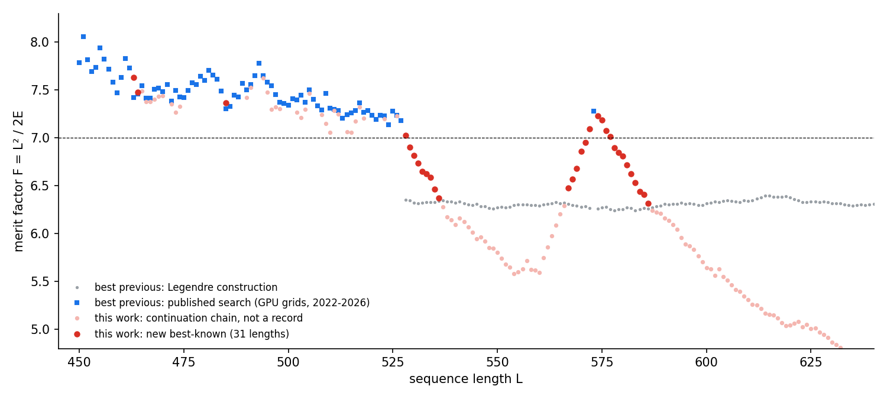

# 31 new best-known low-autocorrelation binary sequences, found with one free GPU

**What this is.** Binary sequences whose aperiodic autocorrelations are all small are used for radar and sonar
pulse compression and for synchronisation in communications. They are also the ground states of the Bernasconi
Ising model, and they are a standard benchmark in recent quantum-optimisation papers (QAOA and others). The
quality measure is Golay's **merit factor** `F = L² / (2E)`, where `E = Σ_k C_k²`. Finding high-F sequences
of length several hundred currently takes clusters of A100 GPUs.

**What we found.** We used one free Google Colab T4 GPU and a laptop, about one hour of GPU time in total. We report
**31 sequences whose merit factor beats the best value we could find in the literature** for that length:

* **The first published sequences longer than 573 with F > 7.** A July 2026 paper states that L = 573 is the
  longest sequence in the literature with F > 7.0. We give F > 7 at L = 574 (7.2320), 575, 576 and 577.
* **The gap 528–572 is partly closed.** Published searches stop at L = 527 (apart from 573). The best previous
  values there come from the Legendre construction (F ≈ 6.3). We improve 528–536 and 567–572 by up to +0.83.
  Above 573 we improve 574–586 by up to +0.97.
* **Two July 2026 records beaten.** At L = 463 we get 7.6304 against 7.4233 (+0.207), and at L = 464 we get 7.4776
  against 7.4569 (+0.021). Those records came from A100 runs on the Vega supercomputer
  ([arXiv:2607.09688](https://arxiv.org/abs/2607.09688)). We also beat one 2024 record: L = 485, 7.3646 against
  7.3024 ([arXiv:2409.07222](https://arxiv.org/abs/2409.07222)).
* **Reproducibility audit.** Every published sequence we used reproduces exactly: all 35 sequences in Table 3 of
  arXiv:2607.09688 and 77 of the 78 in arXiv:2409.07222. The L = 459 row there has a typesetting artifact in the PDF
  text, and that length is covered by the 2026 table anyway. The verified files are in `data/`.



Every number in this README can be checked with the short, dependency-free verifier:

```bash
python3 verify.py data/new_records.tsv      # recomputes E and F from the raw ±1 sequence, exits non-zero on any mismatch
```

## The new records

| L | F (this work) | best previous F | gain | previous source |
|---|---|---|---|---|
| 463 | **7.6304** | 7.4233 | +0.2071 | arXiv:2607.09688 (A100 grid, Jul 2026) |
| 464 | **7.4776** | 7.4569 | +0.0207 | arXiv:2607.09688 |
| 485 | **7.3646** | 7.3024 | +0.0622 | arXiv:2409.07222 |
| 528 | **7.0258** | 6.3522 | +0.6736 | Legendre construction |
| 529 | 6.8994 | 6.3485 | +0.5509 | Legendre construction |
| 530 | 6.8176 | 6.3240 | +0.4936 | Legendre construction |
| 531 | 6.7348 | 6.3127 | +0.4221 | Legendre construction |
| 532 | 6.6506 | 6.3203 | +0.3303 | Legendre construction |
| 533 | 6.6234 | 6.3283 | +0.2951 | Legendre construction |
| 534 | 6.5865 | 6.3292 | +0.2573 | Legendre construction |
| 535 | 6.4643 | 6.3271 | +0.1372 | Legendre construction |
| 536 | 6.3708 | 6.3415 | +0.0293 | Legendre construction |
| 567 | 6.4746 | 6.3099 | +0.1647 | Legendre construction |
| 568 | 6.5670 | 6.2983 | +0.2687 | Legendre construction |
| 569 | 6.6826 | 6.2900 | +0.3926 | Legendre construction |
| 570 | 6.8611 | 6.2778 | +0.5833 | Legendre construction |
| 571 | 6.9509 | 6.2872 | +0.6637 | Legendre construction |
| 572 | **7.0948** | 6.2655 | +0.8293 | Legendre construction |
| 574 | **7.2320** | 6.2602 | +0.9718 | Legendre construction |
| 575 | **7.1878** | 6.2754 | +0.9124 | Legendre construction |
| 576 | **7.0759** | 6.2808 | +0.7951 | Legendre construction |
| 577 | **7.0120** | 6.2562 | +0.7558 | Legendre construction |
| 578 | 6.8954 | 6.2420 | +0.6534 | Legendre construction |
| 579 | 6.8470 | 6.2515 | +0.5955 | Legendre construction |
| 580 | 6.8070 | 6.2570 | +0.5500 | Legendre construction |
| 581 | 6.7184 | 6.2711 | +0.4473 | Legendre construction |
| 582 | 6.6222 | 6.2655 | +0.3567 | Legendre construction |
| 583 | 6.5305 | 6.2445 | +0.2860 | Legendre construction |
| 584 | 6.4389 | 6.2519 | +0.1870 | Legendre construction |
| 585 | 6.4087 | 6.2651 | +0.1436 | Legendre construction |
| 586 | 6.3131 | 6.2616 | +0.0515 | Legendre construction |

The sequences are in [`data/new_records.tsv`](data/new_records.tsv), with `1` = +1 and `0` = −1.

**About "best previous".** For each length we take the maximum over the published search results in
arXiv:2206.12070 (Dimitrov, lengths up to 527 plus 573 and 1006–1010), arXiv:2409.07222 (450–527) and
arXiv:2607.09688 (35 lengths in 450–573). We also include the best rotated, periodically extended Legendre
sequence for that length, which we computed ourselves (`construct.py`). Its asymptotic F of 6.342 is the
strongest known construction. A literature search (October 2026) found no published search results for lengths
528–572 or 574–1005. If you know of better published values for any of these lengths, please open an issue and
we will correct the table.

## How: record continuation

Searching from scratch at L ≈ 550 takes an A100 grid. We take the opposite approach and **start from the published
records and move to neighbouring lengths**:

1. **Grow or shrink while staying skew-symmetric.** Inserting or deleting one free variable in a skew-symmetric
   sequence of length L, then re-applying the skew rule `s[c+j] = (−1)^j s[c−j]`, gives a skew-symmetric sequence
   of length L ± 2. All odd-lag correlations stay exactly zero. We try every position and both signs, and keep the
   lowest energy (`ops.py`, `fill.py`). In every case we inspected, the best insertion was at one of the ends.
2. **Make even lengths.** We drop or add one element at either end and keep the best. This is repeated until no
   length improves (`merge.py`).
3. **Repair with local search.** We tried a GPU tabu search with iterated perturbation (`glabs.cu`: one CUDA
   block per walk, all candidate flips scored in parallel in O(L)), CPU self-avoiding walks (`labs.c`,
   `labsg.c`) and a GPU beam search (`beam.py`). See the negative results below.

The records lie in deep basins. One continuation step from a record costs only ~0.1–0.25 in F, so the first 5–15
steps away from a record beat the algebraic construction by a wide margin.

## Negative results (so nobody has to repeat them)

* **Short local search never improved a continuation step.** We tried GPU tabu search (160 parallel walks, 40 s
  per length, at every length of two chains: 483→517 and 573→607), CPU skew-symmetric self-avoiding walks (20 s)
  and unrestricted (non-skew) walks (30 s). None ever got a continued sequence below the energy it started with.
  Longer seeded runs (20 min) were started but lost when the Colab runtime was recycled, so this result covers
  short budgets only.
* **Beam search did not help.** A beam of width 128 over all insertion and deletion paths (40 records × 60 steps)
  matched the greedy chain at every length.
* **Continuation decays.** F drops by about 0.1–0.25 per +2 in length. The middle of the gap (537–566) and lengths
  ≥ 587 stay below the construction, so they remain open.
* **From-scratch search on a T4 is not competitive.** Ten minutes of GPU tabu search with a frozen run-structured
  head (the restriction classes of arXiv:2206.12070) reached F = 5.71 at L = 551 and 5.99 at L = 601. The
  construction gives about 6.3 at those lengths.
* **Records are not scale-invariant.** Stretching the run lengths of the L = 451 record (F = 8.06) to L = 501
  gives F = 1.69 (`stretch.py`).

## Reproduce

```bash
python3 verify.py data/new_records.tsv                       # check every claim (stdlib only)
python3 construct.py 450 1100 > data/legendre_baseline.tsv   # construction baseline (numpy)
python3 fill.py out.tsv 50 data/published_arXiv2409.07222_verified.tsv data/published_arXiv2607.09688_verified.tsv
python3 merge.py merged.tsv out.tsv                          # adds even lengths
python3 compare.py merged.tsv data/best_previously_known.tsv
nvcc -O3 -arch=sm_75 -o glabs glabs.cu                       # GPU tabu search (Colab T4)
cc -O3 -march=native -o labs labs.c                          # CPU skew-symmetric self-avoiding walk
```

`fill.py` + `merge.py` regenerate all 31 records in this table in about a minute on a laptop CPU. No GPU is needed.

## Files

| file | purpose |
|---|---|
| `verify.py` | independent energy and merit-factor checker (stdlib only) |
| `data/new_records.tsv` | the 31 new sequences with previous best and source |
| `data/all_best_this_work.tsv` | best sequence we hold for every length 450–674 (records and non-records) |
| `data/best_previously_known.tsv` | best previous F per length and its source |
| `data/published_*_verified.tsv` | published record sequences, re-extracted from the papers and re-verified |
| `ops.py`, `fill.py`, `merge.py` | continuation operators and gap filling |
| `glabs.cu` | CUDA tabu search / continuation engine |
| `labs.c`, `labsg.c` | CPU self-avoiding-walk solvers (skew-symmetric and unrestricted) |
| `beam.py` | GPU beam search over continuation paths (negative result) |
| `construct.py` | rotated, extended Legendre construction baseline |
| `parse_published.py` | extracts sequences from the arXiv:2607.09688 PDF text |
| `compare.py`, `plot.py` | comparison table and figure |

## Open problems this leaves

* Lengths **537–566** and **≥ 587**: can anyone beat F ≈ 6.3 there with a single GPU?
* Is there a search move that escapes the basin of a continued record? None of the local searches we tried did.
* The two July 2026 records we beat came from neighbouring records. Running continuation on every published
  record, in both directions, before starting an expensive search looks like a cheap baseline that is easy to
  overlook.

## Credits

The published records this work builds on are by M. Dimitrov (arXiv:2206.12070); B. Pšeničnik, R. Mlinarič,
J. Brest et al. (arXiv:2409.07222); B. Pšeničnik, B. Bošković, J. Brest et al. (arXiv:2607.09688); and B. Bošković,
F. Brglez and J. Brest ([git_labs](https://github.com/borkob/git_labs) archive).
Released under the MIT licence.
